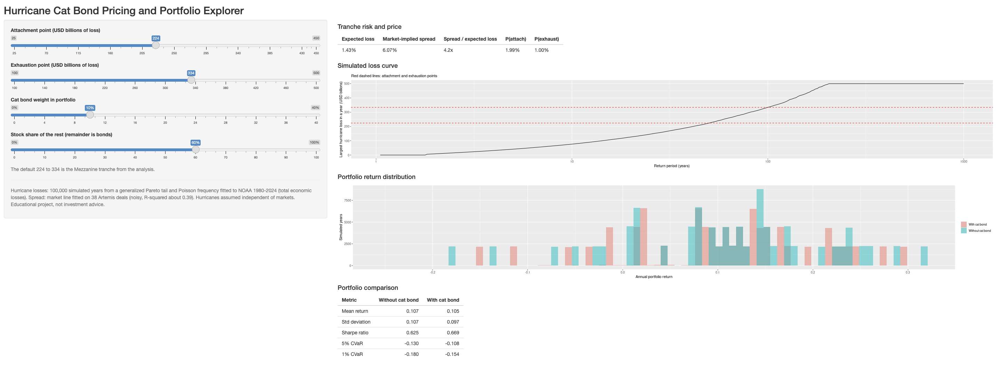

# Hurricane Catastrophe Bond Pricing and Portfolio Analysis

I built a model that prices catastrophe (cat) bonds tied to US hurricane losses, then tests whether adding one to a stock and bond portfolio improves risk-adjusted return. The work uses R, SQLite and Shiny.

**Live app:** https://wilsonweng.shinyapps.io/cat-bond-pricing/
**Full write-up:** [report/report.html](report/report.html) (download and open in a browser)

## What it does

1. **Cleans and stores the data.** NOAA hurricane losses (1980 to 2024), historical stock, T-bill and bond returns, and 38 market cat bond tranches from Artemis go into a SQLite database.
2. **Models hurricane losses.** Large losses use a generalized Pareto tail above a $5B threshold, chosen from mean-residual-life and parameter-stability plots. Yearly event counts use a Poisson model.
3. **Simulates 100,000 hurricane years** and checks the simulated loss curve against the 45 real years.
4. **Prices three tranches** (Junior, Mezzanine, Senior) by computing expected loss, then predicting spread from a log-log line fitted on the 38 market deals.
5. **Tests portfolio diversification** with an efficient frontier, Sharpe ratio and CVaR, with and without the cat bond.
6. **Stress-tests the model** with a parameter bootstrap, a backtest (fit through 2009, test 2010 to 2024), and threshold, cap and event-rate sensitivity.
7. **Adds a SQL risk report** that reproduces the R results from the database.
8. **Shiny app** to change a tranche's attachment and exhaustion points and see price, risk and portfolio impact.

## Main results

| Result | Value |
|---|---|
| Mezzanine tranche (\$224B to \$334B loss) | Expected loss 1.43%, market-implied spread 6.07% |
| Mezzanine expected loss, 90% bootstrap interval | 0.12% to 2.67% |
| Best Sharpe ratio, stock/bond only vs with cat bond | 0.63 vs 0.75 |
| 10% cat bond allocation (54% stocks, 36% bonds) | Sharpe 0.67, and both the 5% and 1% CVaR improve vs the stock/bond mix |
| Optimizer's 38% cat bond weight | Better Sharpe, but the 1% CVaR worsens from -18% to -29% |
| Backtest: hurricanes above \$30B in 2010 to 2024 | Predicted 2.6, actual 9 |

## Limitations

- Only 45 years of data, and the far tail is an extrapolation. Bootstrap intervals are wide.
- The backtest shows a constant event rate understates recent risk. Using the post-2000 rate raises the Mezzanine expected loss by about 40%.
- NOAA losses are total economic losses, not insured losses.
- The spread line is noisy ($R^2 \approx 0.39$) and calibrated on a soft market (2024 to 2026).
- Hurricane losses are assumed independent of market returns.
- Simulated losses are capped at \$500B, which matters for the Senior tranche.

This is an educational project, not investment advice.

## Repository layout

| Folder | Contents |
|---|---|
| `data/raw/` | The three source datasets (CSV) |
| `R/` | Numbered scripts 01 to 09 and `functions.R` |
| `sql/` | SQL queries used by script 09 |
| `app/` | Shiny app and the files it reads |
| `report/` | Quarto report source and rendered HTML |

`data/clean/` is not stored here. The scripts recreate it.

## How to run it

1. Open `cat-bond-pricing.Rproj` in RStudio.
2. Install the packages: `install.packages(c("tidyverse", "janitor", "evd", "MASS", "DBI", "RSQLite", "quadprog", "shiny", "rsconnect"))`
3. Run the scripts in `R/` in order, 01 to 09. In script 08, also save the bootstrap with `saveRDS(boot, 'data/clean/boot.rds')`.
4. Render `report/report.qmd` with Quarto.
5. Run the app with `shiny::runApp('app')`.

## Data sources

- Hurricane losses: NOAA NCEI billion-dollar weather and climate disasters (archived, 1980 to 2024)
- Market returns: Aswath Damodaran, historical returns on stocks, bonds and bills
- Cat bond benchmarks: Artemis.bm deal directory